

  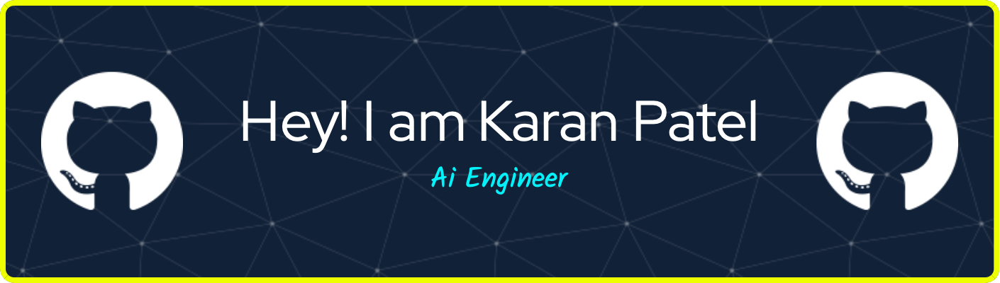

<h1 align="center">👋 Hi, I'm <strong>Karan Patel</strong></h1>

  

---

<h2 align="center">🚀 About Me</h2>

🎓 <strong>MS in Data Science</strong> at <strong>Northeastern University</strong> (Khoury College of Computer Sciences), Boston 
💼 Former <strong>Intern, Intelligent Data Analytics & Cloud at PwC</strong>: SAP Datasphere data models and SAP Analytics Cloud dashboards for a live client engagement 
🤖 I build <strong>AI agents and data systems</strong> that are measured, guarded and shipped: LangGraph, RAG, MCP, FastAPI, DuckDB 
🧪 I care about <strong>honest evaluation</strong>: baselines, held-out tests and clearly stated limitations 
📍 Based in <strong>Boston, MA</strong>, open to <strong>Summer 2027 co-ops and internships</strong>

---

<h2 align="center">⭐ Featured Projects</h2>

| Project | What it does | Results |
|---|---|---|
| **[JoinPilot](https://github.com/Karanpatel3114/joinpilot)** · [Live demo](https://joinpilot.vercel.app) | An AI agent that turns raw ERP tables and a plain-English requirement into a tested, human-approved data model: evidence-backed joins, guarded SQL views, automated integration checks, a KPI dashboard, plain-English questions and an MCP server. *FastAPI, LangGraph, DuckDB, Postgres, React* | 0.993 join F1 on held-out data (best baseline 0.868); 1,248 of 1,248 KPI values correct; 71 of 71 SQL attacks blocked |
| **[SentinelDesk](https://github.com/Karanpatel3114/sentineldesk)** | Bilingual (English and German) AI triage for IT-support tickets: an explainable escalation gate, cross-lingual RAG and grounded reply drafts that must cite their sources. *Python, scikit-learn, FAISS, Gemini, FastAPI, React* | Routes 90.7% of high-priority incidents to a human on a 5,718-ticket holdout (classifier alone: 69.2%); 39 of 39 sampled drafts cite valid sources; 206 tests |

---

<h2 align="center">🛠️ Skills & Tools</h2>

### 🖥️ Programming Languages

  
  
  
  
  
  
  
  

### 🧠 AI / ML / Deep Learning

  
  
  
  
  
  
  
  
  
  

### 🤖 LLMs & AI Agents

  
  
  
  
  
  

### 🗄️ Data & Databases

  
  
  
  
  

### 📊 Data Visualization

  
  
  
  

### 🌐 Backend & Web

  
  
  
  

### ☁️ Cloud, Automation & Dev Tools

  
  
  
  
  
  
  
  
  
  
  
  
  

---

<h2 align="center">📜 Certifications</h2>

🟣 <strong>Oracle Cloud Infrastructure 2025 AI Foundations Associate</strong> (Oracle) 
🟡 <strong>AWS Academy Graduate: Machine Learning Foundations</strong> 
🟡 <strong>AWS Academy Graduate: Cloud Architecting</strong> 
🔴 <strong>Postman API Fundamentals Student Expert</strong> (Postman Academy) 
🔵 <strong>Jira Fundamentals</strong> (Coursera) 
🟢 <strong>CognitiveClasses.ai:</strong> Python for Data Science, Data Science 101, Build Your Own Chatbot, Deep Learning with TensorFlow, Big Data 101, SQL and Relational Databases, Docker Essentials, Data Analysis with Python 
⚪ <strong>Deloitte Data Analytics Job Simulation</strong> (Forage)  

📂 <a href="https://github.com/Karanpatel3114/CERTIFICATES"><strong>Certificate repository</strong></a> 
🎖️ <a href="https://www.credly.com/users/karan-patel.15e49af4"><strong>Verified Credly badges</strong></a>

<table align="center">
  <tr>
    <td align="center">
      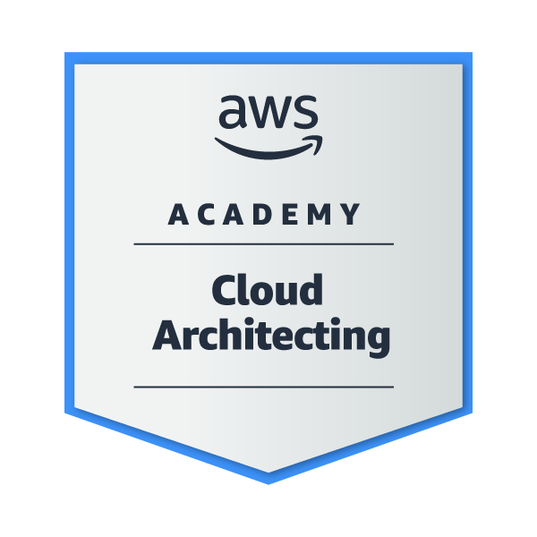 
      <b>AWS Cloud Architecting</b>
    </td>
    <td align="center">
      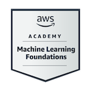 
      <b>AWS ML Foundations</b>
    </td>
    <td align="center">
      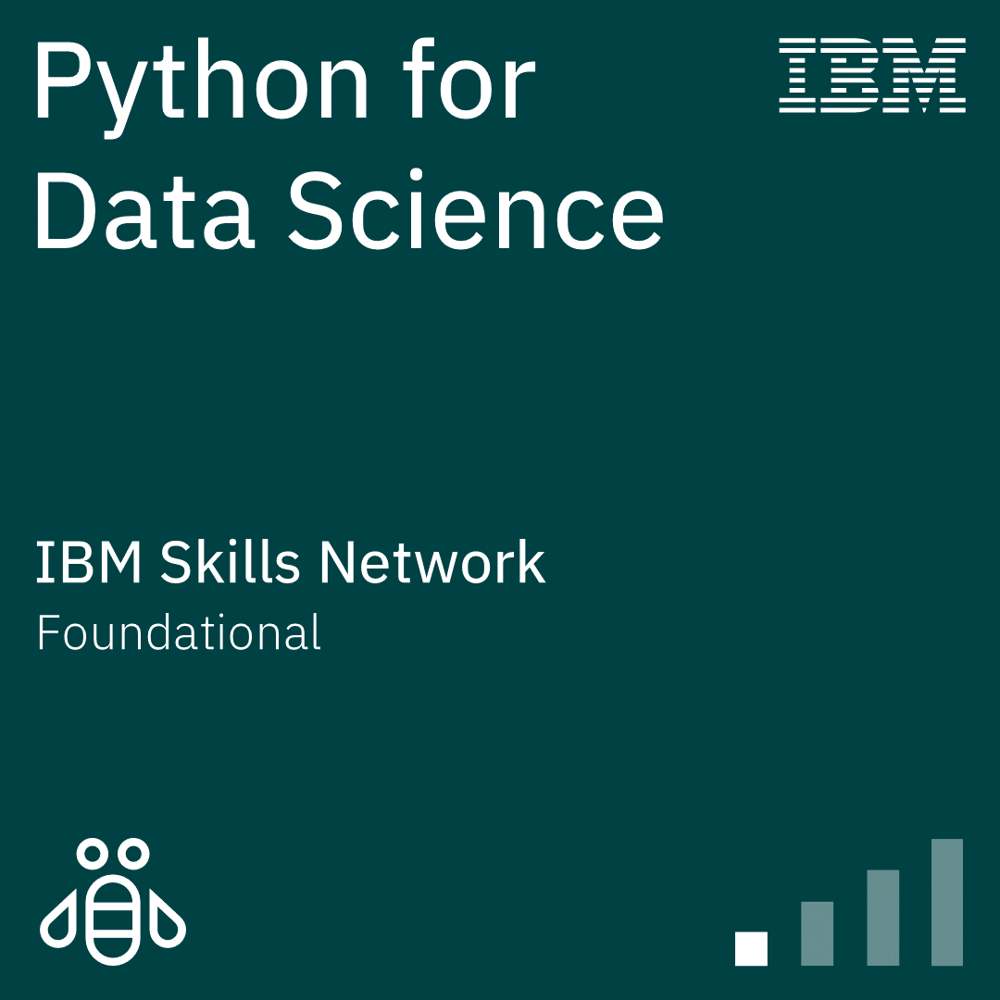 
      <b>Python for Data Science</b>
    </td>
  </tr>
  <tr>
    <td align="center">
      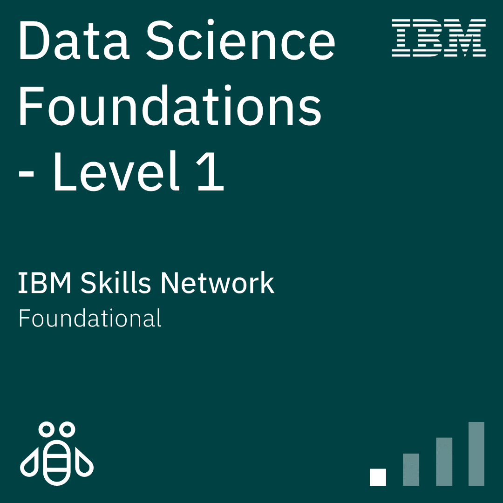 
      <b>Data Science 101</b>
    </td>
    <td align="center">
      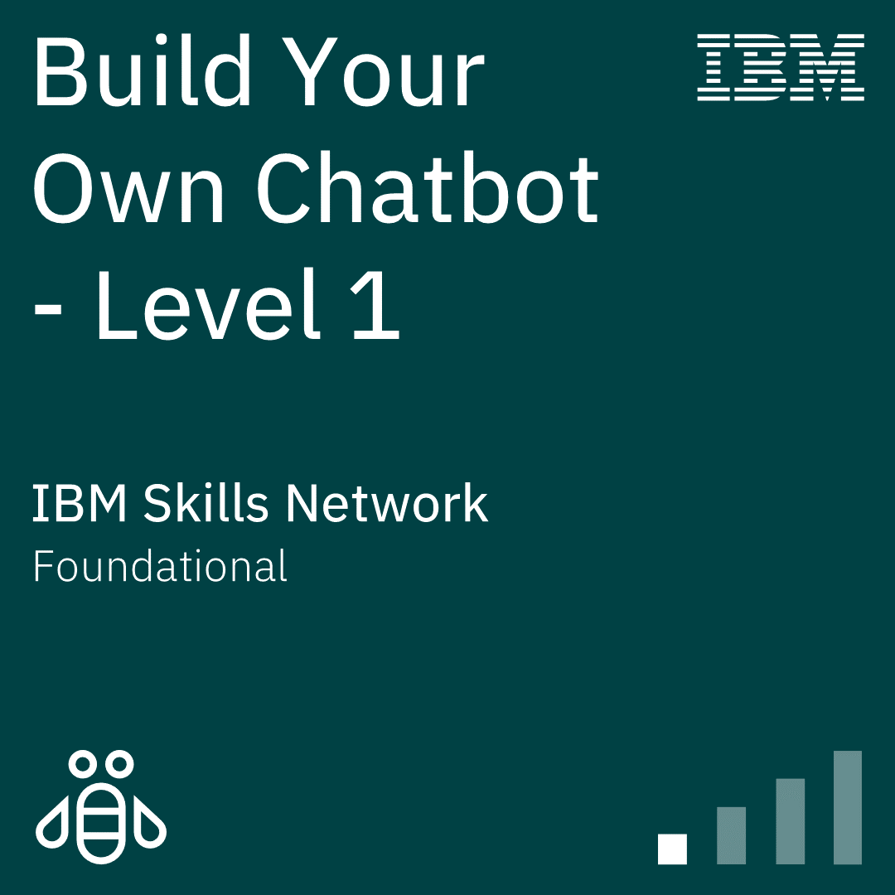 
      <b>Build Your Own Chatbot</b>
    </td>
    <td align="center">
      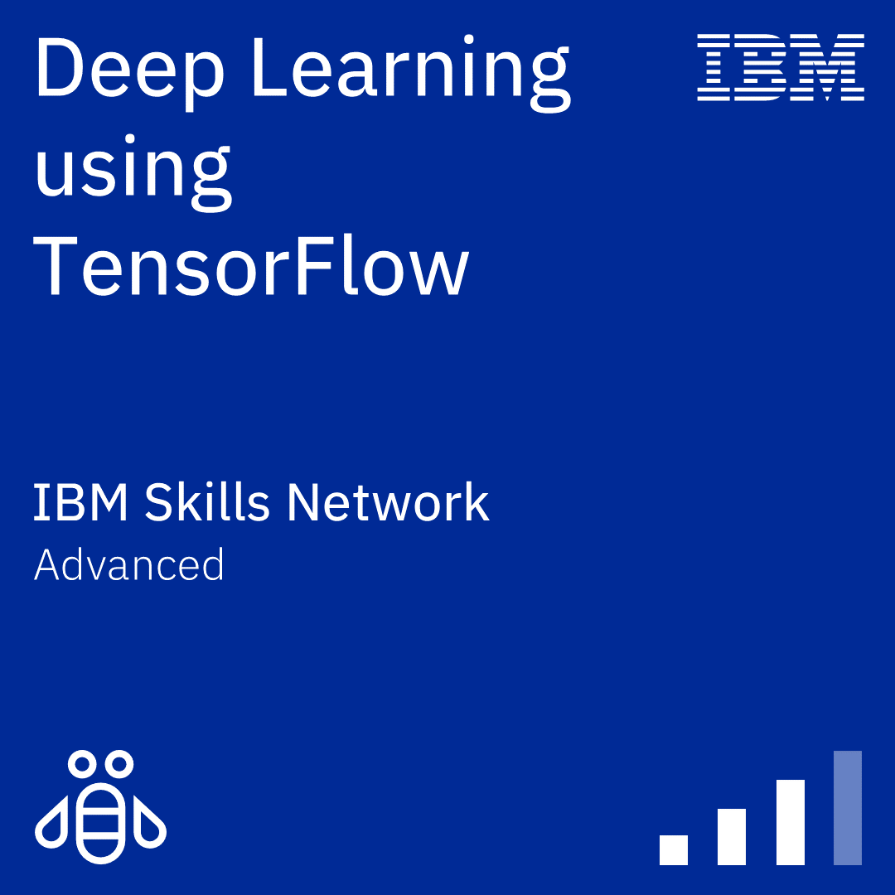 
      <b>Deep Learning with TensorFlow</b>
    </td>
  </tr>
  <tr>
    <td align="center">
      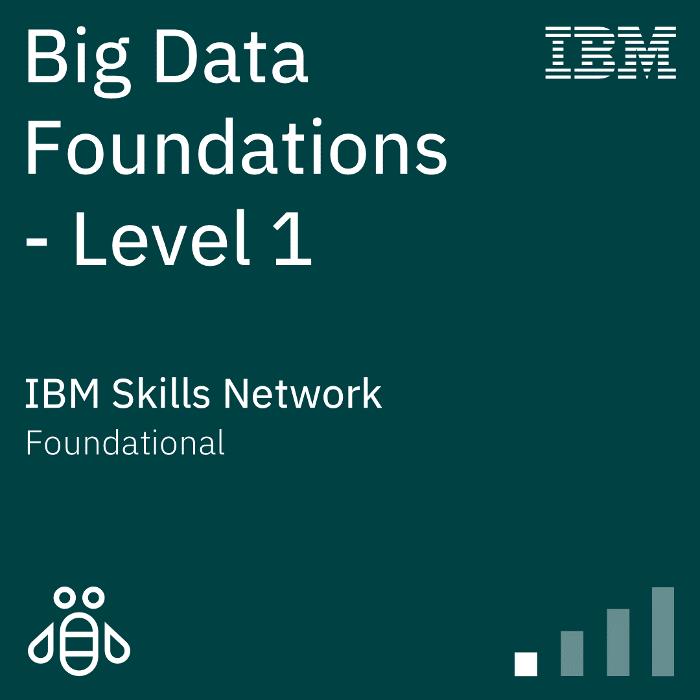 
      <b>Big Data Foundations</b>
    </td>
    <td align="center">
      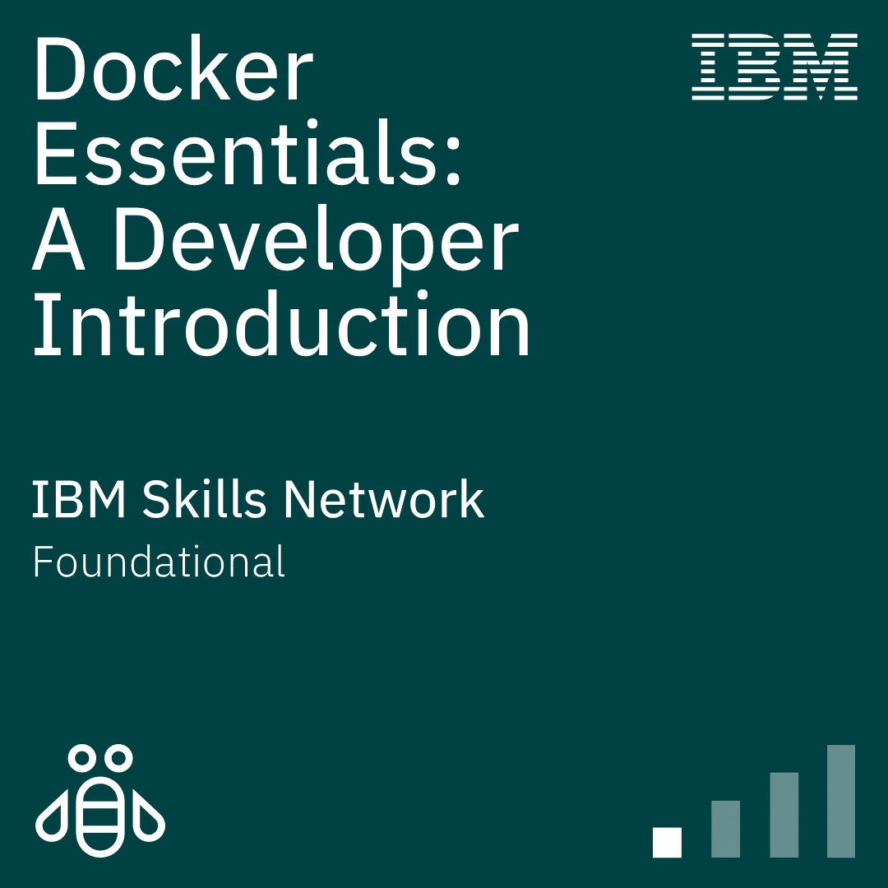 
      <b>Docker Essentials</b>
    </td>
    <td align="center">
      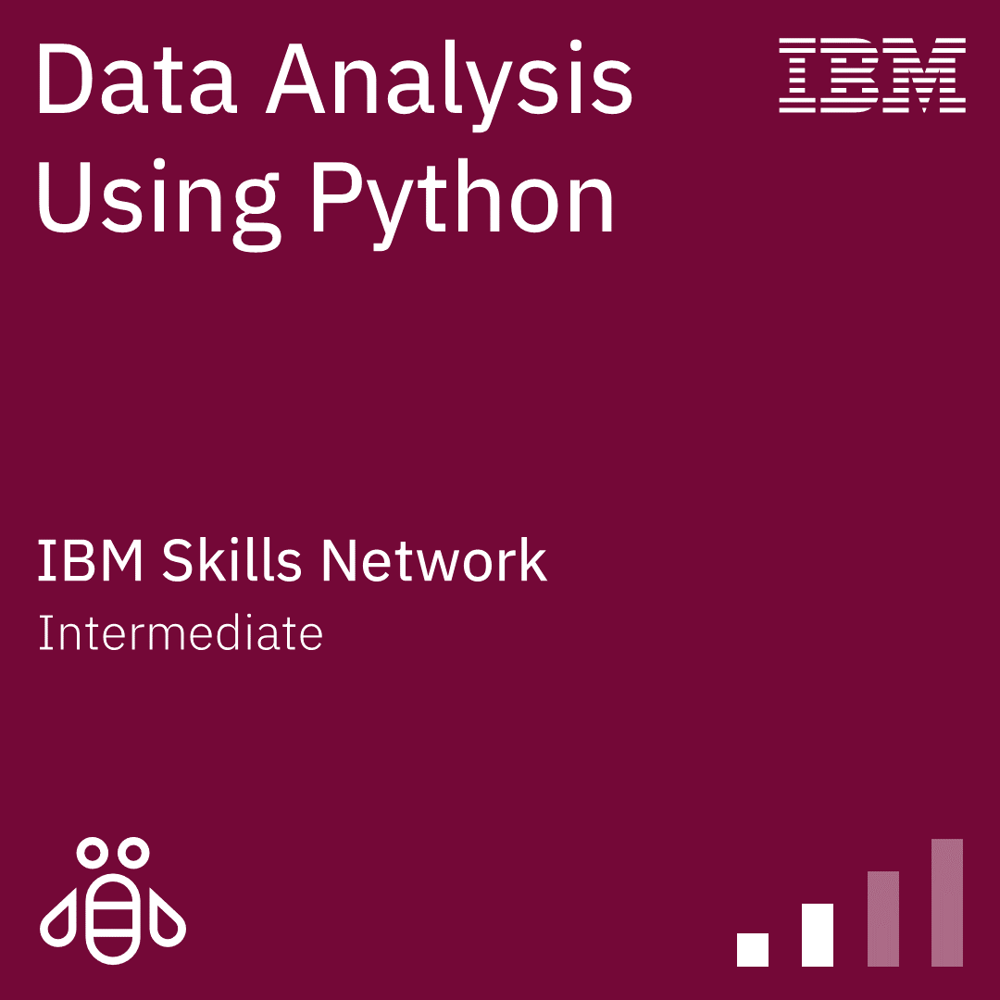 
      <b>Data Analysis with Python</b>
    </td>
  </tr>
  <tr>
    <td align="center">
       
      <b>Postman Student Expert</b>
    </td>
    <td align="center">
      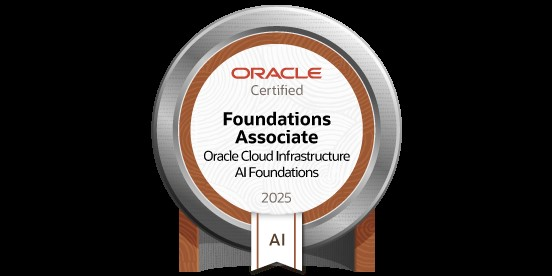 
      <b>OCI 2025 AI Foundations Associate</b>
    </td>
    <td></td>
  </tr>
</table>

---

<h2 align="center">🎯 Current Focus</h2>

🤖 Building and evaluating <strong>LLM agents</strong> honestly: evidence-backed decisions, guarded tools, human approval 
🧠 Next up: <strong>fine-tuning a small open model with LoRA</strong> for document extraction, compared against an API model on accuracy, cost and speed 
📚 Spring 2027 coursework: <strong>Machine Learning</strong> and <strong>Foundations of Artificial Intelligence</strong> 
💼 Looking for <strong>Summer 2027 co-ops</strong> in AI engineering, data science and software engineering

---

<h2 align="center">📈 GitHub Stats</h2>

---

<h2 align="center">📫 Let's Connect</h2>

  📧 <strong>Email:</strong> patel.karanri@northeastern.edu 
  🔗 <strong>LinkedIn:</strong> <a href="https://www.linkedin.com/in/karan-patel-727769217">karan-patel-727769217</a> 
  🌐 <strong>Live project:</strong> <a href="https://joinpilot.vercel.app">joinpilot.vercel.app</a>

